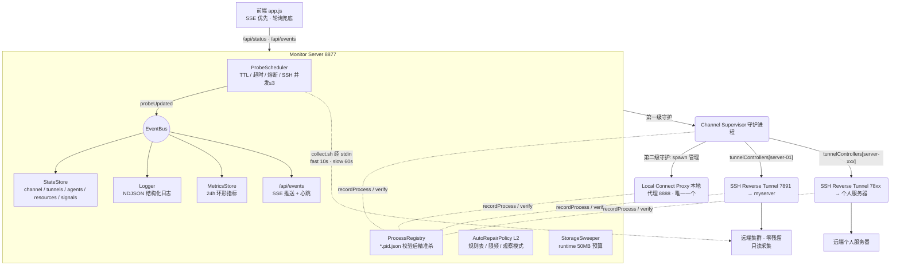

# 架构与内部实现

> 本文从 [README](../README.md) 拆出，面向想了解控制台内部结构的维护者；日常使用只需看 README 顶部的「快速上手」。

## 📂 项目结构

v2.29 起代码按「入口薄、模块小、目录即归属」组织：每个运行入口只做装配，具体逻辑放在同名目录下的小模块里（单文件多在 50–350 行）。下面按进程/层次列出。

### 运行入口（只做装配）

| 入口 | 进程 / 角色 | 逻辑所在目录 |
| --- | --- | --- |
| `electron-main.mjs` + `preload.js` | Electron 主进程与渲染进程网桥 | `work/monitor/desktop/` |
| 根目录的 `electron-bootstrap.mjs` | 固定启动引导：先恢复中断的安装版更新，再加载主进程 | `lib/self-update/package-recovery.mjs`（固定协议，变更需完整安装包） |
| `work/monitor/monitor-server.mjs` | 控制面：HTTP + SSE + 探针内核（端口 8877） | `work/monitor/server/`、`work/monitor/lib/` |
| `work/monitor/channel-supervisor.mjs` | 数据面守护：本地代理 + 每台服务器一条 `ssh -R` | `work/monitor/lib/supervisor/` |
| `work/local_http_connect_proxy.mjs` | 数据面：本地 HTTP CONNECT 代理（8888） | `work/monitor/lib/proxy/` |
| `work/monitor/public/app.js` | 前端控制台 | `work/monitor/public/assets/js/{app,render}/` |
| `scripts/setup-wizard.mjs` | `npm run setup` 配置向导 | `scripts/setup/` |
| `scripts/setup-undo.mjs` | `npm run setup:undo` 撤销集群侧受管配置（可选释放端口登记） | `lib/onboarding-guide/undo.mjs`（与配置页的「撤销接入」共用）、`lib/cluster-env.mjs` |
| `scripts/hot-update.mjs` | `npm run app:update` 热更新 | `scripts/hot-update/` |
| `scripts/release-promote.mjs` | `npm run release:promote` 发布方推进稳定版分支 `stable`（只快进、终端确认后才推、从不强推） | `lib/self-update/channel.mjs` |

入口路径是**稳定契约**：进程命令行签名、pid 记录、`pkill` 兜底与打包脚本都按这些路径识别进程，不要改名或挪位置。

### 目录与职责

* `work/monitor/desktop/`：Electron 主进程模块（`context` 共享状态与动作表、`monitor-process` 后台拉起与退避、`vault` 凭据保管、`export-file` 配置导出的另存为、`windows`（主窗口的大小与位置记忆在 `window-bounds`，存 `runtime/window-state.json`；悬浮岛钉在桌面的开关与位置、菜单栏数字的选项在 `widget-prefs`，存 `runtime/widget-state.json`）/ `tray` / `tray-glance`（托盘图标旁的数字，macOS；与悬浮岛共用 `public/assets/js/render/glance-model.js`，主进程里唯一 import 前端模块的地方）/ `ipc`、`quit` 退出与停止顺序、`control-plane` 重启界面与热更新监视、`crash-watch` 自身故障可见、`diagnostics-save` 诊断包的保存对话框）。**不 import `electron`**，Electron API 由入口经工厂参数注入，便于 `node:test` 用假对象驱动。
* 管理角色统一由 `lib/team-admin/protocol.mjs` 的 `isAdminUser` 判断：当前 SSH 账号为 root 或命中 adminUsers。`lib/storage-admin/service.mjs` 通过配置服务保存页面填写的目标与目录范围；配置只预填当前连接、不自动发 SSH。顶部多连接选择与服务器页选择共用 `app/server-switch.js`，统一渲染同步两个选择器；添加入口复用 `server-cards.js` 的登记表单，各连接独立保存账号和密钥。
* `work/monitor/server/`：monitor-server 的装配模块（`start.mjs` 按固定顺序调用各工厂；`kernel` 日志与存储、`telemetry` 事件监听、`incident-sync`（事实 → 事件存储；处置操作受理即把 operationId 关联到未解决的隧道/通道事件，供「查看处置日志」）、`auto-repair*`、`probe-backoff`（探针退避的装配：证据与恢复信号接线、状态视图）、`bridge-ingest`、`snapshot-poller`、`runners`、`services`、`http-server`、`lifecycle` 关停顺序等）。只属于控制面。
* Windows 进程查询的绝对系统工具路径、CIM/WMI 降级、仅存活降级证据与指数退避在 `lib/processes/windows-query.mjs`；GPU 按实际节点账号过滤在 `lib/probes/gpu-visibility.mjs`。两跳连接由 `ssh-route.mjs` 和凭据执行器统一处理；节点与账号以连接 id 隔离，GPU 和存储各自记忆多选，不改变全局查看视角。存储绑定 connectionId 时仍只调用预装的只读服务，不自动提权。
* Windows 本机进程查询统一由 `lib/processes/query.mjs` 使用 CIM JSON 完成；supervisor 启动前以 `lib/supervisor/singleton.mjs` 的命名管道独占同一运行目录，锁持有至进程退出。父进程只发起启动，不抢先登记 PID；热交接退场同一安装目录的旧 Windows supervisor，保留 SSH 与代理。
* `work/monitor/lib/`：控制面与数据面共用的内核模块（纯逻辑为主、可单测），完整清单见下表。按领域再分子目录：
  * `lib/http/`：HTTP 层。`http-router.mjs` 只负责鉴权、operation 上下文、按顺序跑路由组、404/500；`io` / `static` / `sse` / `status-payload` 与 `routes/<领域>.mjs`（status、logs、metrics、servers、config、channel、incidents …）各管一块 API。
  * `lib/state/`：状态仓的分层构建（channel / tunnels / agents / resources 层、`legacy-status` 旧字段兼容契约、状态迁移时间线）。`state-store.mjs` 是持有状态的门面。
  * `lib/probes/`：各探针实现（`processes` 本地进程、`collect` 快慢两条零残留采集、`validation`、`register` 注册）。`probes.mjs` 的 `createChannelToolkit` 是唯一入口。
  * `lib/supervisor/`：数据面守护的内部模块（`service` 主循环与唯一状态对象、`tunnel-controller` / `proxy-controller`、`handoff` 交接与关停、`snapshot-writer`、`tunnel-spec` 隧道参数与签名、`sibling-handover` / `sibling-tunnel` 同账号多台 Mac 接力等）。
  * `lib/proxy/`：本地代理的内部模块（整个目录都在代理的热更新指纹闭包里）：
    * `protocol.mjs`：代理 ↔ supervisor 的进程间约定（环境变量 / 控制文件 / stdout 标记 / 健康头），两侧 import 同一份。
    * `server.mjs`：代理的 http.Server——`/proxy-health`、明文绝对地址转发、CONNECT 隧道、在册连接跟踪与交接的 bind 重试 / 释放排空。
    * `handoff.mjs`：热更新平滑交接里代理进程这一侧的时序与动作（释放监听请求、旧连接最多跑 15 分钟后退出）。
    * `target-policy.mjs`：目标放行策略（非 443 白名单团队层 ∪ 个人层、默认 allowTarget）与拨号前逐地址复检的 DNS rebinding 闸门。
    * `address.mjs`：地址纯判定叶子模块（CONNECT authority 解析、端口校验、私网 / loopback 字面量、白名单条目与上游代理地址解析）；`config-loader.mjs` 也引它做写入校验，所以只放稳定纯函数。
    * `dns-cache.mjs`：拨号用的 DNS 正缓存（all:true 全量缓存，失败不缓存）。
    * `upstream.mjs`：出网方式 system / manual 时经上游 HTTP 代理拨号（`CONNECT host:port` 后交回 socket，明文请求 absolute-form 转发；只支持 http:// 上游、不带认证）。
    * `system-proxy.mjs`：识别本机系统代理当上游（macOS `scutil --proxy`、Windows 注册表、其余读 `*_proxy` 环境变量；只取 HTTP 代理，SOCKS / PAC 只报告），结果缓存 30 秒。
    * `policy-reload.mjs`：代理策略的加载与热重载（每 2 秒按文件戳重读团队 / 个人层，system 模式每 30 秒复查系统代理；任何失败只告警、保留上一份生效策略）。
    * `headers.mjs`：明文转发与上游请求前剥逐跳头。
    * `resolver-canary.mjs`：本机解析器健康金丝雀，决定上游模式下解析失败是否放行。
  * `lib/egress/`：出网设置的控制面模块（v2.54；不放 `lib/proxy/`，避免进代理的指纹闭包）：
    * `relay-url.mjs`：中转站 base URL 的出网归类（none / allowlist / direct-candidate / invalid，http:// 明文告警），设置页白名单输入与登录引导共用。
    * `self-test.mjs`：出网自测，分两段报告哪一跳坏——本机经代理对官方入口做 CONNECT + TLS 握手；可选 SSH 到活跃服务器经反向端口 `curl -x` 打全链路。
    * `service.mjs`：`/api/egress*` 的业务层——读 / 改出网方式与个人白名单（一律经 `savePersonalConfig`，代理约 2 秒内自行热载）、跑自测。`getEffective()` 只出生效方式与上游（给出网健康用，不读口令与使用记录）。
    * `egress-health.mjs`（v2.65）：出网健康，结果只在内存快照里（`/api/status.egressHealth`）。主动：代理按 manual / system 生效且有上游时每 30 秒对上游连一次 TCP（连上即断、不发字节；生效方式沿用 60 秒）；被动：`bridge-ingest` 的 `onMessage` 旁路把 supervisor 消息里的 `[proxy] connect-fail` 按 refused / timeout / rejected / other 计近 10 分钟（按日志行 ts，不留原始消息）。判 unknown / error / warn / ok；fixture 模式不探测。
  * `lib/agents/`：各 Agent 的适配器（codex / reclaude / zcode / claude-code）、固定注册表（`registry.mjs` 的冻结 `ADAPTERS` 列表）与共享的标记段提取 `marker-section.mjs`、诊断探针的自适应节奏 `steady-interval.mjs`（连续 3 轮 ok 后从 90 秒降到 5 分钟，任何非 ok 立即回 90 秒；doctor 与 claude-code 共用，通道恢复时两者都插队补跑）。`claude-code.mjs`（v2.57）是官方 Claude Code：一次 SSH 跑 `remote/cli-probe.sh` 的 Claude 部分，给出安装 / 版本 / 登录方式，并经本人反向端口 `curl -x` 打 `api.anthropic.com`；不参与全局健康聚合。`app-server.mjs` / `app-server-service.mjs`（v2.85）：前者是 Codex 客户端常驻 app-server 的只读端口解析、漂移判定与固定重启命令；后者是用户点「重启守护进程…」时才发 SSH 的业务层（`POST /api/codex/app-server/restart`，SSH 占全局槽位、同一时刻一个），doctor 探针在原有那次 SSH 里顺带取回端口，不新增探针。
  * `lib/self-update/`：源码安装（同事 git clone 后 `npm run start`）从 GitHub 自更新（v2.59）；v2.62 起按「更新通道」跟：安装目录在 `stable` 分支就跟 `origin/stable`（稳定版，发布方用 `npm run release:promote` 手动推进），在 `main` 就跟 `origin/main`（开发版，每次推送都收到），别的分支不自动更新。这边定期 `git fetch`，所在通道的远端版本号更高就在横幅上提示，点了才更新。对外：`/api/self-update*`（`lib/http/routes/self-update.mjs`）与命令行 `npm run update`（`scripts/self-update.mjs`）。
    * `package-update.mjs` / `package-bundle.mjs`（v2.95）：Windows 安装版从正式 Release 的 SHA-256 资产摘要验证小更新包，限制大小、路径、架构与运行时版本，复用隔离服务自检；文件事务保留一份备份与恢复记录，保留团队配置、个人配置及运行数据。`package-recovery.mjs` 与根固定引导不会被热更新覆盖：启动前恢复未完成事务，新启动成功后确认；启动失败、超时或未确认就再次启动时恢复旧版。更新不替换运行中的 exe、不改数据面进程的路径与身份，沿用现有控制面重启。构建脚本 `scripts/build-update-package.mjs` 仅在构建时使用，运行时不 import 它。Electron 或固定引导不兼容时转完整安装包。
    * `service.mjs`：检查（`inspectInstall` 判安装形态 → fetch → `planUpdate` 给出能不能一键更新及原因）、应用（临时工作树里自检目标版本 → 只做快进合并 → 写 `runtime/self-update.json`）、回退（`reset --keep` 回到那次更新之前，并在更新记录里记下被退掉的提交 `skipTarget`：远端还停在它上面期间不再给更新，命令行 `npm run update -- --force` 是装回去的出口）、`resumeAfterRestart`（更新后的那次重启自动把守护进程平滑交接一次）。只认 `origin/main`；本地有改动 / 不在 main / 有自己的提交 / 依赖变了（`lockNeedsInstall`，锁文件里只是根版本号跟着变不算）/ 这台电脑的 Node 不满足目标版本的 `engines.node`（`platform.parseNodeEngineRange` + `isNodeVersionSupported`；此时不给「在终端里更新」的命令）时不给按钮、说明原因。「不是 git 仓库」只在 git 自己这么说时才下结论：目录归属被 git 拒绝（dubious ownership，Windows 上常见）是单独一种，说明里带放行命令；git 超时之类只算这一次没读出来（`error.code: inspect-failed`，之前的结论留着）。定时检查每一轮都重新看安装目录（不在 main 上时不联网），处理完不用重启就能接上。不碰个人配置、端口与隧道。
    * `git.mjs`：git 调用的唯一出口——参数数组、`GIT_TERMINAL_PROMPT=0`（凭证失效直接失败，不在后台等输入）、上游代理只接受 `http(s)://主机:端口`、地址里的凭证不外露、fetch 失败归因。
    * `smoke.mjs`：合并前的自检——把目标版本的源码树以 fixture 模式起一遍（`lib/fixture-monitor.mjs`），`/api/session` 与 `/api/status-lite` 回 200 才算过；运行时没有第三方依赖，临时工作树不需要 `node_modules`。
    * `restart-code.mjs`：网页模式「请把我重新拉起来」的退出码与环境变量约定，以及启动器把自己的 Node 版本带给监控服务的环境变量（桌面模式下服务跑在 Electron 自带的 Node 上，预检 `engines.node` 要对启动器那个）；`scripts/launch.mjs` 与监控服务两边引用，无依赖。
    * 更新之后的生效复用现成的两段：源码安装的版本号取 `package.json`（`build-info.mjs` 的 `parseSourceVersion`），磁盘上的版本变了 → 「重启界面」（桌面壳 `app.relaunch`，网页模式监控服务以约定退出码结束、由 `launch.mjs` 重新拉起）；重启后守护进程是旧代码 → 平滑交接。打包的 `.app`（发布方自己那份）不走这条路，仍用 `npm run app:update`。
  * `lib/onboarding-guide/`：App 内接入引导（v2.60，设计稿第 3 期）——把命令行向导 `npm run setup` 的前半段做成界面能驱动的一串步骤：连接服务器并核对指纹 → 专用密钥 → 用一次密码装公钥 → 保存连接配置 → 领端口 → 起隧道 → 出网自测 → 写集群侧配置。装 CLI 与登录不在这里，界面接着用 `/api/cli*`。对外：`/api/onboarding*`（`lib/http/routes/onboarding.mjs`）与 `/api/status.onboardingGuide` 摘要。
    * `service.mjs`：步骤编排。每步幂等、失败停在那一步、「重试」从它继续；要人回答的地方（指纹 / 密码 / 是否覆盖已有 Host 段 / 是否改用系统代理 / 是否注释旧代理导出）以 `prompt` 交给界面，回答经 `answer()` 送回。密码只在内存里走一趟（10 分钟不用就丢）。团队配置的服务器条目写了 `sshHostKeyFingerprints` 时指纹自动核对、不再问人。fixture 模式是一套不碰网络与文件的假流程（冒烟 / 预览用）。
    * `store.mjs`：进度落 `runtime/onboarding-guide.json`（0600）；只存走到哪一步与表单里的用户名 / 地址，重启后正在跑的步骤回到「已暂停」。
    * `local-key.mjs`：本机专用密钥 `~/.ssh/id_ed25519_codextunnel`（无口令，绝不读写默认密钥路径）；命令行向导新建密钥用的是同一个文件名。
    * `authorize-key.mjs`：用专用密钥免密探测；用一次密码装公钥（系统 ssh + `ssh-askpass.mjs` 的本机通道，公钥走标准输入，远端去重追加）；通道走不通时给人复制的手动命令。
    * `cluster-env-apply.mjs`：集群侧受管配置的非交互写入（命令全部来自 `cluster-env.mjs` 的纯函数，与命令行向导写出来的逐字相同）。
  * `lib/cli/`：官方 CLI（codex / Claude Code）的检测、安装更新与登录（v2.57 第 2 期）。三条线共用一份目录、一把锁、一个刷新入口；对外：探测快照挂 `toolkit.cli`，安装业务层挂 `toolkit.cliInstall`，最新版本 `toolkit.cliVersions`，锁 `toolkit.cliTaskLock`（`lib/probes.mjs` 装配）。
    * `catalog.mjs`：两种 CLI 的静态事实，全仓唯一一份——`CLI_IDS` / `getCli` / `isCliId`、npm 包名、Linux 平台产物、`--version` 解析（`parseVersionText`）、官方安装布局、安装形态归类、`compareVersions` / `isUpdateAvailable`（预发布段逐段比）、Agent kind ↔ CLI id。
    * `detect.mjs`：组装 `remote/cli-probe.sh` 的调用并把输出解析成 `CliState`（安装 / 版本 / 形态 / 登录方式；登录只看凭证文件的存在性与类型，不执行 `codex login status`、不读出密钥）。`installed` 的口径是「非交互 SSH 的 PATH（外加 `~/.local/bin`）里找得到」——工作台的 doctor / 安装 / 登录都经非交互 SSH 执行。只装在交互 shell 才看得到的位置（nvm、npm 自定义前缀、conda、`~/.claude/local`……）时 `installed` 仍为假，但多带一个 `offPath`（`~/…` 形式，只在这种情况下出现）：Agent 卡片转黄并说「已安装在 …，但非交互 SSH 的 PATH 里找不到」、给处理建议，不归进中性的「未安装」。候选位置的清单只有一份，写在 `cli-probe.sh` 里；codex doctor 探针经 `buildOffPathLocateCommand` 用同一份清单、同一算法分清「未安装」与「不在 PATH」（只看固定目录，不启动交互 shell、不执行找到的文件）。
    * `service.mjs`：`cli:<serverId>` 探测服务（与用量同一采集范围 `isCliEligible`、10 分钟一轮，结果只进内存快照；某轮 SSH 失败保留上一份）——`toolkit.cli.getSnapshot` / `refresh`。快照带两个时刻：`checkedAt`（结果到手，对外的「检查时间」）与 `startedAt`（SSH 发出之前）。
    * `install-service.mjs`：`/api/cli*` 的业务层（`toolkit.cliInstall`）——概览（探测快照 + 安装 / 回滚结果覆盖层 + 最新版本 → `{ serverId, clis: { id: { ...CliState, label, latest, updateAvailable } }, job, busy }`）、安装 / 更新任务与进度、回滚；覆盖层与探测快照谁新，按快照的 `startedAt` 比（一轮跨过安装完成时刻的探测读到的是安装前的状态，不能凭结束得晚压过覆盖层）；只对活跃团队服务器，SSH 经 `acquireSshSlot`，上传长连接不占槽位、也不经凭证执行器——密码连接（条目带 `authRef`）的服务器只走官方路径，「直接用本机下载」409，官方失败时说明为什么没回退（概览带 `fallbackUnavailable`）；`buildInstallDeps` 供命令行向导复用。
    * `versions.mjs`：本机每 6 小时查 npm dist-tags 的 `latest`（只在内存缓存，失败 10 分钟内不重试）。
    * `net.mjs`：本机侧 HTTPS（元数据 / 下载）按个人层出网设置选路：直连 / 系统代理 / 手动上游，CONNECT 复用 `proxy/upstream.mjs` 的拨号器。
    * `sources.mjs`：读官方安装脚本核实的下载源、布局与校验方式（文件头），解析回退路径要下的同款产物。
    * `download.mjs`：本机可续传、可换源、按官方 sha256 校验的下载（Claude 有 `.zst` 时本机解压再校验），缓存 `<dataDir>/cli-downloads/`。
    * `remote-scripts.mjs`：安装相关远端命令——预检 / 官方安装器后台任务（setsid + nohup，`~/.cache/cluster-workbench/cli/jobs/`）/ 轮询 / 结束 / stdin 上传复核 / 解包落盘冒烟切软链 / 回滚，全部 `wrapSh`、插值前白名单校验。官方安装任务 source `env.sh` 后先把 `keys/*.env` 引入的变量逐个 unset 再联网（下载来的安装器只拿到代理变量与 PATH）；从任务目录读出的 pid 一律先过 `read_pid`（纯数字且大于 1）才拿去 `kill`。结束命令回报是否确认结束（`alive=0|1|unknown`，TERM 后还活着补 KILL；已自己退出的不再发信号）；codex 落盘遇到已存在的正式目录先挪到 `releases/.old.*`、新目录就位才删，失败挪回。
    * `install.mjs`：编排一次安装任务（首选经隧道跑官方安装器，失败 / 卡住 / 超时回退本机下载上传，旧版本保留）与回滚。卡住 / 超时先结束远端任务，确认已结束才回退；确认不了（SSH 不通、启动时回话丢了、任务目录不见了）就失败并说明，不回退——官方安装器与回退并行会交错改安装目录。可取消（`options.signal`，工作台 `POST /api/cli/jobs/:jobId/cancel` 与向导 Ctrl+C 同一条路）：官方阶段结束远端任务、下载阶段中止并删掉本机安装包、上传阶段杀 ssh 子进程并清远端半截文件，落盘 / 切软链期间不可取消（`job.cancellable=false`）；取消后 `status="cancelled"`、任务锁随收尾释放。
    * `team-cache.mjs`（v2.89）：团队 CLI 安装包缓存 `<hubDir>/cli-cache/<cli>/<版本>/<官方产物文件名>` 的纯函数——列表（拼进安装预检）、集群内拷贝进私有上传目录并核 sha256、管理员发布（stdin 写 `.part` → 核字节数与 sha256 → 改名，0755 / 0644，共享根目录不存在时拒绝）、清旧版本（只删自己的）、`chooseCacheEntry`（首次安装有就用；更新只用不旧于最新版的）。缓存只是字节来源，sha256 以本机向官方取的清单为准。
    * `publish.mjs`（v2.89）：管理员「发布到团队缓存」任务（本机下载 → 上传共享目录 → 每个 CLI 留 2 个版本），与安装共用任务快照、任务表、取消与进度接口（`action: "publish"`）。
    * `smoke-test.mjs`（v2.89）：测试对话——集群上经 `env.sh` 跑 `codex exec --sandbox read-only` / `claude -p` 发一句话，按 stdout 里的约定回复判通过，失败归类（Key / 额度 / 权限 / 模型 / 未登录 / 网络 / 超时），输出打码。
    * `task-lock.mjs`：每台服务器同一时刻一个 CLI 任务（install / rollback / login / undo / publish / smoke），全仓唯一实现、唯一实例：安装业务层与登录服务注入同一把（`server/start.mjs`），提示按占用者的 kind 区分。
    * `refresh.mjs`：安装 / 回滚 / 登录之后的刷新入口（`server/start.mjs` 创建一次，安装路由的 `onCliChanged` 与登录服务的 `onLoginChanged` 共用）：重测 `cli:<serverId>`，成功时补跑 codex → `doctor`、Claude → `claude-code` 探针。
    * `test-support.mjs`：lib/cli 单测夹具（临时「集群 HOME」+ 真实 `/bin/sh`，不 ssh、不联网）。
    * `login-flows.mjs`：纯函数——四种登录方式的远端命令（一律 `wrapSh`；伪终端会话先 `stty cols 4000` 防长链接折行、打印 pid、在 `timeout` 硬上限下 exec；Codex 先查集群 1455 是否被占）、伪终端输出解析（去 ANSI / OSC 8，授权链接只认官方域名）、codex `config.toml` 的 `model_providers.<id>` 保格式 upsert、Claude `settings.json` 的 API 键补丁（reclaude 接管时拒绝）、中转站地址判定说明、脱敏。
    * `login-api.mjs`：API key / 中转站流程（先测通再写：非 443 加个人白名单、内网地址集群直连测通后先重写 env.sh 的 NO_PROXY、成功才记进个人层 `noProxyExtra`，没领端口或集群上没有 env.sh 时跳过重写并说明；key 只经 ssh 标准输入，落 `keys/*.env` 600）。App 与命令行向导共用。
    * `login.mjs`：`/api/cli/:cli/login*` 的业务层——任务管理（锁用 `task-lock.mjs` 的共用实例）、账号授权的伪终端会话（`ssh -tt`，Codex 另加 `-L 1455` v4/v6 转发且不复用连接）、授权码回写、两道超时与取消时的本机 / 远端清理。路由在 `lib/http/routes/cli-login.mjs`，前端是 `app/cli-login-dialog.js`。
  * `lib/incidents/`、`lib/servers/`、`lib/shell/`：事件存储与持久化、服务器条目校验与摘要、shell 工具。`lib/shell/` 下：`quote.mjs` 是 POSIX sh 单引号包裹；`remote-file.mjs` 生成远端原子写文件命令（备份 + tmp + mv；经标准输入整文件替换时给 `mode` 则先把空 tmp 收紧到该权限再写内容；剥离块时 `requireShebang` 先读 2 字节确认 `#!` 再 grep，不白读 ELF），向导与集群侧受管配置共用；`wrap-sh.mjs` 把远端脚本包成 `sh -c '<脚本>'`（换行写成 csh 也接受的续行、`!` 移到引号外转义），交给 ssh 的命令不再依赖对方登录 shell 是 bash / sh（tcsh / csh 也成立）。事件存储每类（指纹）只留最近 50 条已恢复记录，另按「指纹 × 北京自然日」记已恢复事件的次数（随 `incidents-closed.json` 落盘，留 31 天；旧文件没有计数时按留存记录回填并标出不完整的日子），供 `GET /api/incidents/summary` 的按类型汇总。事件中心的三个纯函数模块（2026-10-23）：`clusters.mjs` 把同一类、间隔 ≤15 分钟的连续事件合成「事件簇」（`GET /api/incidents?group=cluster`；未解决事件另带 `recurrence`「短时间内第几次」）；`disposition.mjs` 是事件上的处置记录（处置受理经 `incident-sync` 的 `linkOperation` 追加，恢复记「N 秒后恢复」、3 分钟仍未恢复记「未恢复」，随事件落盘）；`context.mjs` 是事件前后经过（`GET /api/incidents/:id/context`，只读断线账本、历史日文件的信号与启停、内存日志环、其它事件，不发 SSH）。前端对应 `render/incident-insights.js`。
  * `lib/usage/`：Agent 用量（v2.41）。`scan` 远端扫描的调用组装与输出校验、`store` 本机按天持久化与去重、`model` 纯函数聚合（KPI / 趋势 / 日历 / 项目 / 会话 → 轮次 → 调用）、`service` 采集范围与一轮扫描；`usage:<serverId>` 探针随 slow 采集一起在 `registerLoadProbes` 里按服务器注册，路由在 `lib/http/routes/usage.mjs`。
  * `lib/brief/`：今日简报（v2.43）。`model` 纯函数把当天事实整理成「一句话结论 + 四格指标（隧道 / 事件 / 用量 / 我的作业）+ 值得留意（≤3 条）」，文案随快照落盘；`service` 取数（断线账本、事件存储、用量、作业、历史采样的磁盘趋势、codex doctor 可升级）、今天实时生成（缓存 60s）、跨过北京时间 0 点后定稿昨天；`store` 归档 `runtime/briefs/<YYYY-MM-DD>.json`（单份 ≤32KB，只保留最近 31 天，写入与每 5 分钟定时都会清理）。路由在 `lib/http/routes/brief.mjs`（`GET /api/brief?day=`、`GET /api/brief/days`），前端是概览右栏的简报卡片（`render/brief-view.js` + `app/brief-controller.js`）。
  * `lib/jobs/`：「我的作业」（每日简报与服务器页「我的历史」的数据源）。`scan` 内联 POSIX sh 远端脚本（经 stdin 送 `sh -s`）与调用组装、`parse` 纯函数解析 sacct 输出（远端本地时间按 tz 换算、状态 / 退出码 / 时长归一，对照远端总行数标出是否没拿全）、`service` 一轮采集与按服务器的内存快照 `getSnapshot(serverId)`、`model` 纯函数（结局归类 `jobOutcome`——简报与历史共用一套口径；`buildJobsHistory` 把快照聚合成历史接口的响应）；`jobs:<serverId>` 探针与 `usage:<serverId>` 同一采集范围、同在 `registerLoadProbes` 里注册，服务挂在工具箱的 `jobs` 上。
* `work/monitor/remote/`：经 stdin 送到远端执行的只读脚本，服务器上不落文件：POSIX sh 的 `collect.sh`（快慢两条采集），以及 Python 3.6+ 的 `usage-scan.py`（Agent 会话日志的增量用量扫描）。例外是 `cli-probe.sh`（官方 CLI 探测，v2.57）：唯一写入是版本缓存 `~/.cache/cluster-workbench/versions`（按可执行文件真实路径 + mtime + 大小，没变就不再执行 `--version`）。

v2.50 的新增模块沿用上述归属：`lib/jobs/watch-{store,model,scan,service}.mjs` 管关注偏好、通知事实、日志进度与作业资源复盘，远端 `job-watch.py` 只在原 jobs 探针的 SSH 槽内执行；`desktop/job-notices.mjs` 独立于窗口轮询本机收件箱，`app/job-notifications-controller.js` 管网页收件箱与浏览器通知，`app/job-navigation.js` 保持通知跳转的服务器上下文。`lib/reports/` 汇集本机已存证据并脱敏，`http/routes/reports.mjs` 提供只读报告 API。`lib/usage/anomalies.mjs` 与 `anomaly-rules.mjs` 复用已有用量记录计算最近一小时的异常和保存项目软阈值，前端独立实时区域不跟随历史日期切换。新数据写入 runtime 范围，关注文件最多 2MB、40 组/200 作业，提醒和资源复盘按 30 天有界保留；用量规则最多 128 项。关停在排干 HTTP 后最多等待在途采集 1 秒，再排干已排队的存储写入；用户关注修改始终等待保存完成，不受采集等待预算截断。

v2.51 继续沿用同一归属：`lib/jobs/subrun-model.mjs` 与远端 `job-subruns.py` 在关注采集的同一次 SSH 内按增量游标解析编排作业的 LAUNCH/END 与子任务训练日志，游标存 `runtime/job-subruns.json`；`lib/jobs/lookup.mjs` 与 `http/routes/jobs-lookup.mjs` 提供按需 sacct 回查，结果不进 snapshots；`lib/jobs/log-{paths,segment,readback}.mjs` 与远端 `log-segment.py` 只按本机登记路径分段读取日志并校验文件身份；`lib/usage/error-text.mjs` 归类并脱敏失败调用原文；`lib/dir-usage/` 与远端 `dir-usage.py` 只在用户点击时有界扫描 $HOME，结果有界存本机。新增按需 SSH（回查、日志分段、目录扫描）全部经 `acquireSshSlot` 占全局槽位。

v2.53：直连节点（node04）的各卡利用率由 `server/telemetry.mjs` 从同一轮 slow 采集的 slurm 段取出，写进资源样本的 `nodeGpuUtil`（`lib/metrics-store.mjs` 校验），前端 `resources-model.buildGpuGroups` 按节点分组、`gpu-trend.js` 按节点取走势。v2.50 的用量实时异常（`lib/usage/anomalies*.mjs`、`/api/usage/anomal*`、前端 `usage-anomalies-*`）已删除。

v2.98.1：`lib/state/direct-node-resources.mjs` 在资源层投影时补全失败的登录节点跳采：同时匹配已保存连接的节点标识与实际 hostname，使用 150 秒内成功的独立 slow 采样，经 `slurm.directNodeFromResource` 转成相同节点指标。主集群和独立连接的采样到达顺序不影响展示；账号、时效和连接歧义检查不通过时保留原结果，普通账号不借用其它账号的明细。该投影不发 SSH、不修改原始快照或 Slurm 调度状态；独立连接仍由现有探针采集。存储管理另列尚未绑定扫描目标的已保存连接，管理员选择目录后配置，只读服务接入与扫描状态分别判断。

v2.55 远端守护进程：`lib/daemons/commands.mjs` 是固定注册表（只有 `paseo` / `t3code` 两个 id）与常量远端脚本（经 stdin 送 `bash -s`，无任何插值）及白名单输出解析；`lib/daemons/service.mjs` 只对活跃的团队服务器查状态（10 秒短缓存、并发合并）与启动（同一时刻一个、端口已在监听即空操作，从不 kill / restart / stop），SSH 经 `acquireSshSlot`，启动写运维日志与状态时间线。路由 `http/routes/daemons.mjs`（`GET /api/daemons`、`POST /api/daemons/start`，随 `daemons` 模块开关），前端是服务器页面板（`render/daemons-view.js` + `app/daemons-controller.js`）。这是 v2.31.0 移除远端动作后唯一放开的两条固定启动命令。

v2.57 CLI（第 2 期）的入口：路由 `http/routes/cli-login.mjs`（`/api/cli/:cli/login*`、`/api/cli/login/*`）在 `http/routes/cli.mjs`（`GET /api/cli`、`POST /api/cli/:id/install`、`GET /api/cli/jobs/:jobId`、`POST /api/cli/:id/rollback`）之前注册，两组路径互不重叠。前端三处分工：Agent 卡片（`render/cli-model.js` + `app/cli-controller.js`，读 `/api/cli`、404 安静降级）只读展示版本 / 登录方式，「可更新到 x」chip 与详情里的「安装…」经 `settings-cli.openFor` 直达配置浮层「命令行工具」一节（`app/settings-cli.js`，安装 / 更新 / 回滚的唯一操作处）的同一个确认；登录只在 Agent 详情「登录 / 切换账号…」（`app/cli-login-dialog.js`）。命令行向导：集群侧配置（4）→ `scripts/setup/cli-install.mjs`（5，检测 / 安装，复用 `buildInstallDeps` 与 `install.mjs`）→ `scripts/setup/cli-login.mjs`（6，登录）→ 依赖检查（7）。

v2.62 这一轮（设计稿 `docs/superpowers/specs/2026-10-12-completeness-round-design.md`）新增的模块，仍按上面的归属放置，都不新增 `lib/` 顶层模块：

* **提醒规则**：`lib/jobs/watch-rules.mjs` 是纯函数（规则规整与校验、`*` / `?` 通配、作业归属、建议前缀、失败提醒文案）；`lib/jobs/watch-auto.mjs` 是一轮采集里对关注数据的同步改动（自动进组与名额、自动组随规则增删、「这一批已全部结束」、失败提醒），由 `watch-service.mjs` 在 jobs 探针同一轮（取证之后）调用。规则存 `job-watch.json` 的 `settings[serverId].rules`，同文件的 `failures` 记见过的失败作业。失败提醒不属于任何关注组（`watchId: null`、`kind: "failed"`），判定与失败诊断共用 `service.mjs` 的同一个函数；自动组带 `auto.rule`，总上限里手动关注优先。接口沿用 `/api/jobs/watch`。不新增 SSH、运行时文件与远端落盘。
* **磁盘增长归因**：`lib/disk-growth/` 按作业登记（`jobs/registry.mjs` 的 `list`）推出「集合目录」（`collections.mjs`，纯函数），把目录占用扫描器（`remote/dir-usage.py`，未改）的扫描根指过去量各直接子目录的大小。`service.mjs` 不注册探针，自己每 5 分钟看一次：满 6 小时、或磁盘比上次量完时涨了 1 个百分点且满 1 小时就量；一次测量多轮 SSH（每轮 ≤20 秒、歇 2 秒、总共 ≤10 分钟），经 `acquireSshSlot`，用户在扫目录占用时让路。`model.mjs`（增长、占比、文案）、`store.mjs`（`runtime/disk-growth.json`，≤256 KB，14 天）、`detail.mjs`（与简报的 `diskTrendFor` / `daysToFullText` 拼成磁盘事件卡片上的那句话）。路由 `http/routes/disk-growth.mjs`，前端 `render/disk-growth-view.js` + `app/disk-growth-controller.js`。随 `jobs` 模块开关。
* **服务直达**：`lib/daemons/services.mjs` 是拼进守护进程状态脚本的常量远端片段与解析（`ss -ltnp` 里带 `pid=` 的行即本人的监听，再按 `/proc/<pid>` 属主核一道）；`forward-spec.mjs`（纯函数）给出转发用的 ssh 参数、要避开的本机端口与命令行特征；`forwards.mjs` 是转发管理器——每条转发一个独立的 `ssh -N -L 127.0.0.1:<系统挑的端口>:<回环>:<远端端口>`，不复用连接，开前 `ssh -G` 预检（`~/.ssh/config` 给这台主机配了转发就拒绝），最多 4 条、每条 2 小时，记 `runtime/service-forward.<serverId>.<端口>.pid.json`，启动后按进程注册表清孤儿，关停时先于排干在途请求收到 SIGTERM。请求只有服务器与端口，端口须在 90 秒内的服务列表里。路由 `POST /api/daemons/forward`、`/forward/close`。
* **代理口令与使用记录**：监控服务是 `runtime/proxy-auth.json` 的唯一写入方（`lib/egress/proxy-auth-store.mjs`）；本机代理用现有的 2 秒热重载读它（`lib/proxy/policy-reload.mjs`），判定顺序为畸形 400、环路 508、口令 407、放行策略 403，`/proxy-health` 豁免且不带口令信息。默认 `off`，那时代理对外行为与 v2.61 逐字节相同。代理把按目标的使用记录与当前生效的口令模式写进 `runtime/proxy-usage.json`（`lib/proxy/usage.mjs`，仅在模式不是关时），监控只读（`lib/egress/proxy-usage-view.mjs`；v2.65 起 `/api/egress/usage` 另带 `recording` 与 `recent`——本进程见过的相邻两版逐桶相减的增量，只见过一版或 150 秒没重写时为 null）。`lib/proxy/auth.mjs` 与 `usage.mjs` 在代理指纹闭包里；控制面的四个模块（`proxy-auth-store`、`proxy-usage-view`、`proxy-auth-service`、`remote-proxy-auth`）刻意放在 `lib/egress/`，不进任何数据面闭包，supervisor 闭包不含口令。口令发到集群只经标准输入，绝不进本机或集群的命令行；能碰口令原文的模块清单由 `scripts/proxy-auth-wiring.test.mjs` 守着。整体重写集群 `env.sh` 时带不带口令只有一条规则（v2.64，`lib/cluster-env.mjs` 的 `credentialForEnvRewrite`）：本机口令模式打开着就带，是关时集群上原来带着才带，本机没有口令时与以前逐字相同；命令行向导第 4 步（`scripts/setup/proxy-credential.mjs` 经同一个存储模块、同一套数据目录解析只读口令）、接入引导与登录引导（`cluster-env-sync` 的 `credentialForRewrite`）都按它走，后台的端口同步只保住、不新加。已是「强制」而集群上不是当前口令时，`/api/egress` 的 `proxyAuth.clusterAlert` 给出警告（`enforceRisks` 仍只是切换前的确认清单）。
* **更新通道**：`lib/self-update/channel.mjs` 是通道的静态事实（`stable` / `main`），服务、`scripts/self-update.mjs`、`scripts/release-promote.mjs` 共用；两个安装器各有一份同名常量，`scripts/installer.test.mjs` 守着一致。跟 main 时每次联网检查另用一次只读的 `git ls-remote` 得知远端有没有 `stable`。`service.mjs` 的 `switchChannel` 是换通道的唯一实现，只有命令行一个入口（`npm run update -- --channel …`）。
* **接入管理**：`lib/onboarding-guide/undo.mjs`（撤销编排，命令行与界面共用）、`undo-survey.mjs`（预览用的只读查看命令）、`access.mjs`（端口登记列表、释放闲置端口、撤销的预览与执行；执行期间占用 `cli/task-lock.mjs` 的 `undo`，与接入引导互斥）。路由 `http/routes/onboarding-access.mjs`（`/api/onboarding/access*`），前端 `app/settings-access.js`。SSH 全部按需。
* **开机自启**：`lib/autostart/`——`launch-flag.mjs` 是启动器与监控服务共用的约定（`--autostart`、`CODEX_MONITOR_AUTOSTART`、`CODEX_MONITOR_LAUNCHER_PATH`、自启文件里的标记）；`launch-agent.mjs` 与 `windows-startup.mjs` 是两种自启文件的纯函数生成与读回（macOS 用户级 LaunchAgent `com.clusterworkbench.launcher`，登录时 `/bin/bash start.sh --autostart`，写入启动器当时的 PATH；Windows 是启动文件夹里的 `cluster-workbench-autostart.cmd`）；`service.mjs` 是 `/api/autostart` 的业务层：开只写文件，关先 `launchctl bootout` 再删（这一份就是自启拉起来的则不 bootout），只动带标记的文件，fs / exec / 路径全部注入。打包的 `.app` 走 Electron 登录项（`desktop/login-item.mjs` + IPC `get-autostart` / `set-autostart`）；桌面壳入口在加 PATH 前缀之前，经 `desktop/context.mjs` 的 `stripDesktopPathEnv` 把启动器的 PATH 留给自启文件。`scripts/launch.mjs` 认 `--autostart`：网页模式不开浏览器；退出码 75 的重新拉起仍由它自己做，自愈不了的失败以 0 退出，免得 launchd 反复重拉。
* **休眠归因**：隧道控制器发现挂钟跳变（相邻两次 ensure 隔了 90 秒以上）时往断线账本多记一行 `wake`（跳变长度 `sleptMs`，不带 serverId）；跳变期间或醒来后 120 秒内发现的断线，`down` 行带 `sleep: true`。只是记账，重连、退避、残留会话回收都不看它。读侧见模块清单的 `tunnel-ledger-stats.mjs`；简报在统计区间里电脑休眠满 10 分钟时多一条中性的说明，不改结论。
* **采集细化**：slow 采集多带两样，不增加 SSH。① `gpuapp=` 行尾追加进程所在的 Slurm 作业号（取自 `/proc/<pid>/cgroup` 里从层级根开始的 `/slurm/uid_<uid>/job_<id>/`，取不到留空）。② 新段 `proc-top`（排在 `slurm` 之前，≤1 KB）：一次 `ps` 取 %CPU 最高的 28 个与常驻内存最高的 12 个进程，按 cgroup 分作业内外、按账号汇总，最多 6 个账号，只有账号名与数字 → `layers.resources[id].procTop`。%CPU 是进程启动以来的平均值。脚本另认一个只给测试用的 `CT_FS_ROOT`。
* **经隧道出网的程序**：slow 采集的 `tunnel-egress` 段（排在 `proc-top` 与 `slurm` 之间，≤2 KB，不增加 SSH）：端口取 `CT_PORTS` 的第一个（就是这台服务器的 `remotePort`，本机 `toPort` + `assertSafePort`、远端再卡纯数字与 1–65535），一次 `ss -tnpi state established '( dport = :<端口> )'`（有 `timeout` 时限 3 秒），只认对端是回环地址的连接，按程序名汇总连接数与 `bytes_acked`（没有时退回 `bytes_sent`）/ `bytes_received`，最多 20 个程序。非 root 的 `ss -p` 只标本账号的进程，别的账号的连接记为「看不到进程」；`ss` 不认 `-p` / `-i` 时退回 `ss -tn` 只数连接，没有 `ss` 报 `absent`。解析在 `lib/tunnel-egress.mjs` → `layers.resources[id].tunnelEgress`；前端是「资源与负载」面板 GPU 区下面的一块（`render/tunnel-egress-model.js` + `render/tunnel-egress-view.js`，由 `render/load-panel.js` 接线），不建隧道的服务器不显示。字节是此刻还开着的连接建立以来的累计，不是一段时间的流量。
* **fixture 模式不碰真实环境**：隔离实例（包冒烟、浏览器冒烟、自更新自检、界面预览）读的团队配置里是真实主机。`server/credential-runtime.mjs` 的 `guardFixtureSsh` 是兜底闸——fixture 下经执行器的 ssh / scp 一律不起进程；此外守护进程面板（`lib/daemons/fixture.mjs`）、接入管理、出网设置、开机自启、磁盘增长各有自己的假数据，CLI 最新版本不联网。看界面仍应在监控进程的 PATH 最前放假的 `ssh` 并拦掉非 GET 请求。

v2.64 工作台自身故障可见（设计稿 `docs/superpowers/specs/2026-10-14-maturity-round-design.md` 的 W1），不新增 `lib/` 顶层模块：

* **故障日志**：来源名在 `lib/diagnostics/log-sources.mjs`，每份只有一个写入方（logger 按本进程记的大小轮转，两个进程追加同一份会超过 2 MB、互相盖掉 `.1`；`scripts/diagnostics-wiring.test.mjs` 守着）。`runtime/logs/desktop.ndjson` 只由 Electron 主进程写——未捕获异常 / 未处理 rejection（带栈，照常运行）、窗口界面进程退出（`render-process-gone`，非 `clean-exit` 1 秒后自动重载，5 分钟内超过 3 次改为弹框给「重新加载」，悬浮岛直接关掉下次重建）、无响应与恢复（带卡住时长）、GPU 等子进程退出（`desktop/crash-watch.mjs`），以及拉起监控服务的失败、异常退出、「连续 N 次异常退出，停止自动重启」与窗口等不到后端（`desktop/monitor-process.mjs` / `windows.mjs`，origin `desktop-shell`）。`runtime/logs/launcher.ndjson` 只由 `scripts/launch.mjs` 写——启动失败、桌面壳起不来改走网页模式、异常退出与「停止自动拉起」（没出事不建文件）。`runtime/logs/renderer.ndjson` 只由监控服务写——页面脚本的未捕获异常与未处理 rejection。三份都是 `createLogger`、2 MB 轮转、只留一份 `.1`；存储清理器按文件名形状认 `logs/` 下的日志与分卷，不用另行登记。
* **页面脚本错误上报**：`public/assets/js/error-reporter.js`（主页面与悬浮岛共用）按消息 + 位置去重、每分钟 ≤10 条、截断、拿到令牌前先攒，失败不重试；`POST /api/diagnostics/client-error`（`lib/http/routes/diagnostics.mjs`）在服务端再规整与限流（`lib/diagnostics/client-errors.mjs`：重复 60 秒内挡下、每分钟 10 条、每小时 60 条、正文 ≤16 KB）。
* **诊断包**：`GET /api/diagnostics/bundle`——`lib/diagnostics/service.mjs` 只读取数（各 ndjson 末尾 ≤300 行、断线账本末尾 ≤200 行、进程登记直接读 `*.pid.json` 不触发 GC、存储占用、合并配置、状态快照、未结事件、版本构建与运行时版本），`bundle.mjs` 组装，`redact.mjs` 整份脱敏（凭据类字段、请求头、Bearer / Basic、URL 口令、命令行口令参数、常见服务商密钥前缀，以及装配处给的已知秘密：本机鉴权令牌、保管库令牌、代理口令含 Basic 编码；主机名、账号名、路径保留——与排障报告的 `redactReport` 口径不同）。入口在配置 →「版本与更新」面板头（`app/diagnostics-export.js`），桌面壳经 IPC `save-diagnostics` 弹保存对话框，网页模式浏览器下载。

v2.64 数据安全（设计稿 `docs/superpowers/specs/2026-10-14-maturity-round-design.md` 的 W4），都只在控制面，supervisor / 本机代理的指纹不变：

* **配置导出 / 导入**：`lib/config-transfer/document.mjs` 是格式与比对的纯函数（导出格式 `cluster-workbench-config` v1：个人层白名单字段 + 模块 / 面板偏好 + 各服务器作业提醒规则；不含令牌、口令、代理口令、钥匙串里的密码、SSH 私钥、运行数据，取值再过 `scrubSecrets`；导入逐项比对出新增 / 修改 / 删除，服务器端口与 `portOverrides` 单列为端口改动、默认不勾；本机有、文件里没有的条目列为删除、一律默认不勾，删的是带端口 / 隧道的服务器时同时算端口改动）；`service.mjs` 编排导出、预览与按勾选写入（服务端重新比对、只认勾选 id；个人层经 `savePersonalConfig`，偏好经 `modules/preferences-store`，作业提醒经作业关注服务）。路由 `http/routes/config-transfer.mjs`（`GET /api/config/transfer`、`GET /api/config/export`、`POST /api/config/import/preview`、`POST /api/config/import`，导入正文 ≤256 KB），前端是配置浮层的「备份与迁移」一节（`app/settings-backup.js`）；桌面窗口里导出走系统保存对话框（`desktop/export-file.mjs`，IPC `save-export-file`）。
* **写前备份与坏文件留档**：`personal-config-backup.mjs`（个人配置写前留最近 5 份）、`corrupt-archive.mjs`（runtime 下 JSON 存储解析失败先留档再重建），见下表。
* **known_hosts**：`known-hosts-file.mjs` 改为只追加、读不出不写。

v2.52 界面外壳：`app/sidebar.js` 管侧边栏开合 / 窄窗浮层 / 细栏提示与吸顶页头条（页名、当前服务器）；`app/skeleton.js` 按面板登记加载骨架的形状与就绪判断（只读 DOM 事实）；`motion.js` 播一次性的图表与数字入场；`empty-state.js` 是全站空状态的唯一渲染函数。内容区 `.console` 是名为 content 的尺寸容器，主内容的断点一律写 `@container content (…)`，对话框在 `<main>` 之外仍按窗口宽。

* `work/monitor/public/`：前端静态资源（无构建步骤，原生 ES module）。
  * `app.js` 入口只做接线；`assets/js/app/` 是控制器（`state`、`session`、`actions`、`dialogs`、`refresh-loop`、`server-switch`、`view-tabs`、`sidebar`、`skeleton`、`settings-dialog`、`incidents-controller`、`server-actions`、`render-pipeline`）。
  * `assets/js/render/` 是各面板的渲染模块（纯模型函数 + 惰性 DOM 访问）；`assets/js/` 根下是共享件（`api`、`sse`、`store` 格式化与转义、`dom-utils`、`thresholds` 资源分档阈值、`toast`、`theme` 等）。
  * `styles.css` 放设计令牌、主题与共享基础样式；各区域样式在 `assets/css/`。悬浮岛是独立的 `island.*`。
* `scripts/`：命令行脚本（向导、启动、热更新、清理、发布扫描、构建）。`scripts/setup/`、`scripts/hot-update/` 是对应入口的步骤模块，`scripts/lib/` 放脚本公共件（`is-main`、`prompt`；`fixture-monitor` 的实现在 `work/monitor/lib/`，这里只转出口）。**运行时代码（`work/`、`electron-main.mjs`）不得 import `scripts/`。**
* 其它：`setup.sh` / `start.sh` / `start-console.cmd` / `*.command` 是启动薄封装（系统 Node 缺失或版本不合适时，两个启动脚本会改用安装器放在用户目录的私有 Node）；`install/install-workbench.sh` 与 `install/install-workbench.cmd` 是发给同事的一步安装器（单文件、可重复运行：备 Node → `git clone` → 桌面图标 → 启动，不依赖仓库里的其它文件，`scripts/installer.test.mjs` 在沙盒里整段跑）；`scripts/build-macos-app.sh` 构建 `.app`（不入库）；`scripts/build-reclaude-offline.sh` 构建 ReClaude 离线包。

## 🧩 目录归属与多 Agent 并行开发约定

v2.99：`onboarding-guide/local-readiness.mjs` 只检查本机密钥是否存在，不将文件存在当成网络或授权成功；缺失所配置密钥时，经引导摘要提示重检。引导的 `form.mode` 区分 `monitor`（完成 SSH 后查看资源，不新建工具通道）与 `full`（端口、通道与集群代理配置），旧版进度按完整模式继续。`render/onboarding-progress.js` 为前八步提供动态下一步，后续工具准备仍用 `onboarding-setup.js`；存储接入指引使用已有生成密钥、安装命令和检测动作。新电脑浏览器验收在 `scripts/lib/onboarding-device-browser-smoke.mjs`，使用独立 fixture 目录与假 SSH 流程。

v2.99.1：存储目录范围可在原目标上修改，连接身份校验与范围变更分开；范围改变只保留当前连接且仍在范围内的扫描索引，服务器授权未覆盖新增范围时以 `roots-update` 提示更新授权，已授权父目录内的子目录直接投影为可用入口。保存仅写本机配置，不执行 SSH；服务器授权仍由既有安装命令明确执行。前端草稿独立于概览轮询，节点卡片提供目录管理入口，浏览器验收覆盖追加、失败重试与 520px 编辑布局。

v2.99.2：`storage-admin/activity.mjs` 只融合现有资源与团队采样。资源须匹配实际 hostname、成功且不超过 150 秒；团队通过 `getCachedActivity` 仅读缓存并核对连接身份，不调用采集或下发。正向观测按 UID+账号名有界保存在原存储状态的 `activity` 中，重绑清除，目录调整保留同连接记录。原始 lastlog 不改写；近期活动、系统登录记录与文件修改各自展示，疑似不活跃只作为待核实线索。前端每 30 秒仅读本机概览（扫描时仍为 5 秒），时间格式复用北京时间函数。

多个 Agent（或多人）同时改代码时，按下面的规则切分，基本不会互相冲突：

1. **按目录认领**。一个任务尽量只动一个区域：前端某面板（`render/<panel>.js` + 对应 `assets/css/` 文件）、某组 API（`lib/http/routes/<领域>.mjs`）、某个探针（`lib/probes/*`）、数据面（`lib/supervisor/*` 或 `lib/proxy/*`）、桌面壳（`work/monitor/desktop/*`）、向导步骤（`scripts/setup/*`）。入口文件（`app.js`、`monitor-server.mjs`、`electron-main.mjs` 等）只在新增装配时才改，改动应是几行接线。
2. **共享件只加不改签名**。`lib/probe-ids.mjs`（探针 id）、`lib/validators.mjs`（serverId / 凭据引用 / 端口 `isPort`·`toPort` 校验）、`lib/status-error.mjs`（带状态码的错误）、`lib/atomic-file.mjs`（私有文件原子写，同步 `writePrivateFileAtomicSync` 与异步 `writeFileAtomic`）、`config-loader.selectMainServer / isServerEnabled`、`process-registry.isPidAlive / cmdlineMatches / parseCmdlineRows`、`ssh-args.buildPinnedProbeSshArgs`、`build-info.parseBuildInfo`；前端 `dom-utils.createElementLookup / copyText / morphInnerHtml / setText / setAttr`、`store.formatBytes / formatBytePair / formatGb / formatClock / escapeHtml`、`thresholds.levelFor / colorFor / finite / clampPct / worstLevel`、`resources-model.freshnessParts / buildGpuModel`、`logs-panel.buildLineRows / entryKey`。需要新能力时新增导出，不要各处再写一份。
3. **数据面代码的放置与指纹**。热更新按「入口的静态相对 import 闭包」计算 supervisor / proxy 指纹（`lib/component-version.mjs`），闭包里的文件变了才走平滑交接。数据面代码只用静态相对 import；改到闭包里的共享件（如 `validators.mjs`、`proxy/protocol.mjs`）会让两个组件都交接，这是预期行为。
4. **打包白名单**。`.app` 只收录根目录的 `electron-main.mjs` / `preload.js` / `package.json` / `config.json`、`work/monitor/` 整棵（不含测试）与 `work/local_http_connect_proxy.mjs`。运行时模块必须放在这些位置；`scripts/bundle-closure.test.mjs` 会检查四个运行入口的依赖闭包。
5. **前端约定**。相对 import 不带 `?v=` 查询串（否则会出现两份模块实例）；`app.js` 静态依赖图里的模块都要在 `index.html` 登记 `modulepreload`（`perf-wiring.test.mjs` 守护）；新文件只放 `assets/js` / `assets/css`；渲染层会整体覆写 `#alertBanner` 与进度条的 className，状态请用 `data-level` 等属性表达。状态色：`state-*` 类只设 `--tone`、`data-health` 只设 `--health`（映射集中在 `styles.css`「状态语气」），圆点写 `var(--tone, 缺省色)`；引用主题色的派生令牌声明在 `body` 上而非 `:root`（自定义属性按计算值继承，声明在 `:root` 会在浅色主题下沿用深色值）。显隐统一用 `hidden` 属性（全局 `[hidden]{display:none!important}`），不要再写组件级 `[hidden]` 规则。
6. **测试跟着源码走**。每个模块的测试放在同目录 `*.test.mjs`；源码级断言（读源码做正则）只断言本文件归属的源码，跨模块的接线断言放在 `scripts/*-wiring.test.mjs`。新增 `lib/` 顶层模块要在下表登记一行（`scripts/architecture-inventory.test.mjs` 守护），子目录模块不需要。
7. **硬约束不变**：零 npm 运行时依赖；`/api/status` 旧字段形状不变（`lib/state/legacy-status.mjs`，有 golden 测试）；控制台发起的 SSH 一律经调度器槽位（并发 ≤3）并带 ControlMaster 复用参数；运行时文件只写 `runtimeDir`；`ps` 带 UTF-8 区域设置。

#### 完整模块清单（78 个，位于 `work/monitor/lib/`）

上文的叙述只展开核心几个模块；下表是目录的完整索引（新增模块必须同步登记，
`scripts/architecture-inventory.test.mjs` 会在两边不一致时失败）。

| 模块 | 职责 |
| --- | --- |
| `agent-creds.mjs` | 真实 Agent 凭据文件（auth.json）的过期时间提取与归一。 |
| `atomic-file.mjs` | 私有文件原子写（目录 0700、文件 0600、唯一 tmp 名 + rename、失败清理）。同步版供凭据库 / 主机密钥 / vault 端点 / 个人配置 / 升级标记 / `pid.json`，异步 `writeFileAtomic` 供运行快照 / 控制信箱 / 事件持久化。 |
| `auto-repair-policy.mjs` | L2 自动修复的纯函数规则表与限频器（四级护栏：enabled / observeOnly / 手动停止静默 / runbook 互斥；执行前复核 `recheck` 与放弃退账 `refund`）。 |
| `beijing-time.mjs` | 北京时间（UTC+8）日界换算的单一事实源：偏移量、`beijingDayKey`（毫秒 → 日期）、`beijingDayStartMs / beijingDayEndMs`、`offsetDay`、`beijingDaysBetween`。历史日文件命名（`history-store`）、按日期读它们的 `metrics-range`、简报、隧道稳定性、排障报告都从这里取；`usage/time.mjs` 是它的秒级包装。与进程的本机时区无关——后端不要再写 `8 * 3600_000`，也不要用 `getHours / setHours / new Date(y, m, d)`。前端对应的一份是 `render/usage-model.js`（`TZ_OFFSET_SEC` / `clockOf` / `dayKeyOf`）。 |
| `bootstrap-steps.mjs` | 离线安装向导：把 `build-reclaude-offline.sh` 的手工链路拆成 7 步可重入流程。 |
| `build-info.mjs` | 运行 / 安装 / 构建三个版本视角的区分（纯逻辑 + 薄 IO）；`parseBuildInfo` 是 build-info.json 解析净化的唯一实现，桌面控制面共用。源码运行没有 build-info.json 时版本取 `package.json`（`parseSourceVersion`，只取版本号不取提交号），所以 git pull 之后同样判得出「磁盘比运行中的新」。 |
| `channel-lifecycle.mjs` | 受管进程命令行匹配（角色 + 配置快照），生命周期判定的共用底座。 |
| `cluster-env.mjs` | 集群侧受管配置（v2.54，纯函数）：`~/.config/cluster-workbench/env.sh` 渲染、`.bashrc` 与登录 shell 配置的引入块、散落代理导出的扫描 / 注释 / 恢复、`~/.claude/settings.json` 的 env 合并（reclaude 接管时跳过；写回沿用原文件的缩进与末尾换行）与撤销步骤。产出远端命令步骤列表（每条都经 `shell/wrap-sh.mjs` 包成 `sh -c '…'`），向导执行，App 内引导复用。 |
| `cluster-env-sync.mjs` | 集群侧受管配置跟随反向端口：配置热载时发现某台团队服务器的反向端口变了，就在后台把集群上的 `env.sh`（及仍指向旧端口的 Claude 代理键）改到新端口——只在 `env.sh` 当前指向变更前的端口时才写，指向别的端口只报不一致；`/api/status.clusterEnv` 的只读检测（10 分钟一轮，有人看界面才查）与 `POST /api/servers/:id/sync-cluster-env` 的强制同步也在这里。没有 `env.sh` 时不创建；不处理 reclaude drop-in 与 zcode 设置。 |
| `collector.mjs` | 零残留远端采集的本机侧调用组装与 marker 分段解析（fast/slow 两条）；v2.62 起另解析 slow 的 `proc-top` 段（按账号汇总的占用现场）。 |
| `component-version.mjs` | 热更新用的数据面组件指纹。 |
| `config-audit.mjs` | 配置审计：密钥引用哈希，避免明文入库。 |
| `config-hot-reload.mjs` | 配置缓存与活跃选择写入。 |
| `config-loader.mjs` | 分层配置加载与字段白名单（团队层 + 个人层合并）。在 supervisor / 本地代理的指纹闭包里：只在控制面写入时用的校验放 `personal-config-write.mjs` / `modules/preferences-store.mjs`，不往这里加。 |
| `control-plane-restart.mjs` | 热更新：控制面（Electron 主进程 + monitor-server）重启编排。 |
| `corrupt-archive.mjs` | 运行时 JSON 存储读到坏文件时的留档（v2.64）：解析失败先把原文件改名为 `<名字>.corrupt-<北京时间 YYYYMMDD-HHMMSS>`（0600，同名最多 2 份，旧的删），经调用方的 logger 记一条 ops 警告（`event: "store-corrupt"`，不带文件内容），再由调用方按空表重建。接入的存储：磁盘增长、事件记录（主文件与已关闭文件）、作业关注 / 子任务游标 / 作业登记 / 失败诊断、目录占用、资源指标、接入引导进度、Agent 用量（日文件 / 会话 / 游标）、简报归档；代理口令文件认不出（任何原因）时在重新生成口令之前留档。`storage-sweeper` 把留档单列为 corrupt，计入预算、超预算时排在多余日志分卷之后先清。只在控制面：不进 `atomic-file.mjs`（数据面指纹闭包）。 |
| `credential-vault.mjs` | 凭据保管：系统安全存储可用性判定与读写。 |
| `data-plane-upgrade.mjs` | 热更新：数据面（supervisor / 本地代理）零断连交接。 |
| `event-bus.mjs` | 全局单例事件总线（probeUpdated / statusChanged / logAppended / levelsRebased），内核各模块据此解耦。 |
| `exec.mjs` | 统一的 execFile 封装（超时、输出上限、UTF-8 跨块解码）。 |
| `gpu-cards.mjs` | nvidia-smi 采集行的解析（纯函数）：`gpu=` 每张卡的显存 / 利用率 / 温度 / 功耗，`gpuapp=` 占用进程按属主合并显存（MPS 守护进程不算），采集账号自己的进程另按行尾的 Slurm 作业号合并（v2.62，`users[].jobs`）。主采集的 `gpu` 段与直连节点的 `hopkv` 共用。 |
| `history-store.mjs` | 历史持久化：状态迁移（timeline）与指标采样按天落盘；另记状态基线（`type:"levels"`：启动 / 跨天 / 状态键集合变化时的全量级别快照与退出时的停止标记；上一个进程非正常退出没留标记时，下次首次落盘前在它最后一条记录处补一条），供时间线泳道按「基线 + 变更」还原。 |
| `host-key-policy.mjs` | 主机密钥文件命名与策略。 |
| `host-key-store.mjs` | 主机密钥指纹库（首次连接核对）。 |
| `http-auth.mjs` | Web 模式鉴权与读接口收口（token 由 Electron 或 `/api/session` 交付）。 |
| `http-router.mjs` | HTTP 门面：鉴权、operation 上下文、按顺序跑 `lib/http/routes/*` 路由组、404/500；静态资源 / SSE / 状态载荷在 `lib/http/`。 |
| `fixture-monitor.mjs` | 以 fixture 模式拉起一个隔离的 monitor-server（临时端口 / 数据目录 / 个人层，不读写真实数据）：热更新的包冒烟、浏览器冒烟、自更新的目标版本自检共用；`scripts/lib/fixture-monitor.mjs` 是它的转出口。 |
| `incident-recovery.mjs` | 事件恢复判定：只消费服务器自身的新端口采样，不依赖视角切换或重复进程快照。 |
| `known-hosts-file.mjs` | 用户自己的 `~/.ssh/known_hosts`：把核对过的主机密钥行去重追加（v2.64 起只追加新增行、不再整份重写，软链接照常写进目标文件；只有文件不存在才当空，其他读错误直接报错、不写；新建 0600）；命令行向导与 App 内接入引导共用。 |
| `local-resource-probe.mjs` | 本机资源采样（CPU 差分而非 ps 的 lifetime 均值、内存、top 进程）。 |
| `log-signals.mjs` | 卡顿反馈信号引擎（纯函数）：签名规则表 + 冷却 / 行级去重。 |
| `log-tail-probe.mjs` | 日志尾巴信号扫描（`createSectionScanner` / `scanSections`）：吃 collector fast profile 的日志段落喂信号引擎，自身不发起 SSH。 |
| `logger.mjs` | 结构化日志：内存环形缓冲 + `work/runtime/logs/<source>.ndjson` 落盘轮转（单份 `.1` 分卷，轮转写 reset marker；历史查询只读 `.1` 与当前文件）。 |
| `m1-fixtures.mjs` | M1 批次共享测试 fixture。 |
| `metrics-range.mjs` | 资源指标的长范围降采样（`GET /api/metrics/range`，7 天按小时 / 30 天按 3 小时取均值）：读 history-store 的按天文件，过完的日子缓存小时桶；附逐条样本的最小 / 最大值。列日期与「哪天算过完」按北京时间（`beijing-time.mjs`，与日文件命名同一份换算），不看本机时区。 |
| `metrics-store.mjs` | 历史指标环形缓冲（每服务器约 24h），按样本类型隔离，去抖持久化到 `metrics.json`。 |
| `onboarding.mjs` | 首次运行引导判定（纯函数），供 `/api/status.onboarding` 与启动脚本共用。引导本身在 `lib/onboarding-guide/`。 |
| `operation-context.mjs` | operationId 归一化与传播。 |
| `operations-runner.mjs` | 单隧道操作的 monitor 侧编排（preview → run → query）。 |
| `personal-config-backup.mjs` | 个人配置的写前备份（v2.64）：个人配置旁边的 `config-backups/` 里留最近 5 份 `config.local.<北京时间>.json`（0600，目录 0700），内容与最新一份相同不重复留，备份失败不挡写入；不放数据目录已有的 `backups/`（那里有别的东西，按份数清理不该碰）。`personal-config-write` 借 config-loader 写前那次 `.bak` 复制的时机调用（被拒绝的保存不留），配置导入在写入前显式调用一次。 |
| `personal-config-write.mjs` | 个人层写入里只属于控制面的部分（v2.57）：`noProxyExtra`（内网中转站直连名单）的写入校验，以及与 `config-loader.writePersonalConfig` 同签名的包装——校验后的值随其余字段同一次原子写落盘。刻意不放进 `config-loader.mjs`：后者在 supervisor / 本地代理的热更新指纹闭包里，改它会多出一次数据面交接（同 `modules/preferences-store.mjs` 的取舍）。 |
| `platform.mjs` | 平台与 Node 版本闸门（与 `engines` 对齐，不引入 semver 依赖）。 |
| `port-registry.mjs` | 反向端口登记（v2.54）：集群共享目录 `/public/agent-hub/ports` 一端口一文件、属主即身份；survey / 原子领取（`set -C`）/ 释放的远端 POSIX sh 脚本生成（经 `shell/wrap-sh.mjs` 包成 `sh -c`）与输出解析（纯函数，setup 向导用）。 |
| `probe-ids.mjs` | 探针 id 的单一事实源（`collect:slow:` / `validation:` / `usage:` / `jobs:` 前缀、`log-signals` 等固定 id 与反解）。 |
| `probe-scheduler.mjs` | 探针调度器：TTL、超时、熔断与 SSH 并发上限（信号量 ≤3）；可选注入主机退避闸门。 |
| `probe-backoff.mjs` | 探针退避状态机（纯逻辑）：一台主机 SSH 连不上时按退避节奏只放行一条探路的；v2.64 起默认开。装配在 `server/probe-backoff.mjs`。 |
| `probes.mjs` | 探针工具箱门面 `createChannelToolkit`，各探针实现在 `lib/probes/`（本地进程 / 快慢两条零残留采集 / 验证），Agent 探针在 `lib/agents/`。 |
| `process-registry.mjs` | 进程注册表：写 `runtime/<name>.pid.json`，停止前校验命令行与启动时间，校验失败拒杀。 |
| `proxy-config.mjs` | 向导写入的 per-user 代理配置生成（reclaude systemd drop-in / zcode 设置补丁 / 单条远端命令的代理前缀）；集群 shell 的代理变量改由 `cluster-env.mjs` 统一管理；控制台不探测 drop-in 漂移。 |
| `readiness-view.mjs` | 能力状态 / 诊断上下文 / 新鲜度的纯投影（T02），主窗口与托盘共用。 |
| `resource-usage.mjs` | 新版资源结构与 CPU 差分计算（纯函数），本机资源探针与远端采集共用。 |
| `reverse-port.mjs` | 反向端口分配的纯函数（setup 向导与控制台共用）。 |
| `runtime-paths.mjs` | 运行目录解析（含打包 App 内外的差异）：`isPackagedApp` 认 macOS `.app` 与 Windows 安装版（`<安装目录>\resources\app`）；打包时数据落 `~/Library/Application Support/codex-tunnel-monitor` 或 `%APPDATA%\codex-tunnel-monitor`。 |
| `runtime-snapshot.mjs` | supervisor 运行快照（读写双方共用，无额外依赖）。 |
| `server-registry.mjs` | 多服务器注册表：增删改、凭据绑定、主机密钥、测试连接与建议反向端口（本机配置 + 远端 `ss -ltn`）；条目校验在 `lib/servers/`。 |
| `signal-triage.mjs` | 卡顿信号根因分类器（纯函数）：把排障 SOP 代码化为 account/auth/channel/upstream/unknown。 |
| `slurm.mjs` | Slurm 集群快照解析（纯函数）：slow 采集 `slurm` 段（只读 sinfo / squeue）→ 节点 CPU 分配 / 负载 / 内存 / GPU 与全体作业队列，远端本地时间按段内 tz 换算；不在分区内的直连节点（`hop=` / `hopkv=`）以 `source:"direct"` 并入节点列表。 |
| `sse-client.mjs` | 极简 SSE 客户端（Node 内置 http，零依赖），供 Electron 主进程订阅。 |
| `ssh-args.mjs` | 探针 SSH 与 supervisor 探测共用的身份 / ControlMaster 片段与主机名硬校验。 |
| `ssh-route.mjs` | 节点账号的单级 ProxyJump 路径、两跳独立身份与临时 SSH 配置（不含密码）。 |
| `ssh-askpass-helper.mjs` | 原生 Node/Electron askpass 入口；仅经本机一次性内存通道取密码，Windows 不用批处理。 |
| `ssh-askpass.mjs` | SSH 密码只留在进程内存；磁盘 helper 不含凭据。Windows 接入引导、监控与隧道显式使用内存 askpass（原生 Node/Electron 的 `--import` 入口）。 |
| `ssh-config-block.mjs` | `~/.ssh/config` 里单个 Host 段的读写（纯函数）：幂等 upsert、读出已有段并区分是不是本工具写的；命令行向导与 App 内接入引导共用。 |
| `ssh-config-user.mjs` | `~/.ssh/config` 的 User 解析（纯函数 + 薄读盘包装）。 |
| `ssh-runtime.mjs` | SSH 运行时的凭据归属：凭据属于显式服务器快照，绝不进 argv / 主机名。控制面的 ssh / scp 在这里统一带 10 秒连接超时，并把每次真实执行的结果交给探针退避。 |
| `stat-cache.mjs` | 按文件戳（ino/size/mtime/ctime）缓存「读文件 → 派生值」。 |
| `state-store.mjs` | 状态聚合器门面：把离散探针结果归并为 channel/agents/tunnels/resources 多层健康模型；分层构建与旧字段推导在 `lib/state/`，保证 `/api/status` 向后兼容。 |
| `status-error.mjs` | 带 HTTP 状态码的错误基类，路由层按 `err.status` 回写响应码。 |
| `storage-sweeper.mjs` | 本地数据预算：`runtime/` 总量硬上限（默认 50MB），按多余分卷 → 坏文件留档（`*.corrupt-*`，v2.64）→ history → 末卷淘汰。同一轮另清两类不看预算的孤儿：没人再读的 `.2` 及更早日志分卷、已退出的 supervisor 留下的空控制信箱目录。 |
| `supervisor-control.mjs` | monitor ↔ supervisor 的本机文件控制信箱（原子认领、崩溃恢复、结果回收）。 |
| `test-timezones.mjs` | 测试用：`inEveryTimeZone` 把同一段断言放到几个别的机器时区下各跑一遍（进程内切 `process.env.TZ`），时区表 `TEST_TIME_ZONES` 同时供 `npm run test:tz`（`scripts/test-tz.mjs`，整套测试换时区跑）使用。 |
| `tunnel-ledger-stats.mjs` | 断线账本统计（纯函数）：把 `runtime/tunnel-ledger.ndjson` 算成每条隧道在给定区间（默认近 24 小时 / 7 天；简报传北京时间自然日）的断线次数、可用率、恢复用时与最长连续在线，另出近 24 小时「在线 / 断开 / 休眠 / 未观测」分段时间线（概览在线条）；电脑休眠（账本的 `wake` 行与 `down` 行的 `sleep` 标记，v2.62）单独记，不算断线、不进可用率，同一段休眠的几次断开并成一条，唤醒后 10 分钟内没连上的才从醒来起记普通断线；supervisor 停机的空档不计入可用率。没有这些标记的旧账本口径不变。 |
| `tunnel-stability-service.mjs` | `GET /api/tunnel-stability` 的数据源：读断线账本（含 `.1`，按文件戳缓存解析结果），只出启用且建隧道的服务器；另附每台近 7 个北京时间自然日的可用率（`daily`，「近 7 天」在线条）。 |
| `tunnel-orphan.mjs` | 孤儿反向隧道判定（纯函数）：自家旧隧道认领为健康，端口被异己占用则长退避，绝不杀进程。 |
| `tunnel-egress.mjs` | slow 采集 `tunnel-egress` 段的白名单解析（纯函数）：此刻连着登录节点 `127.0.0.1:<remotePort>` 的连接按程序名汇总的连接数与已收发字节（字节缺失为 null），另有看不到进程的连接数；远端没有 `ss` / 查询失败给 `state: absent / error`。 |
| `upgrade-marker.mjs` | 数据面升级「在飞」标记（`runtimeDir/data-plane-upgrade.inflight`）。 |
| `validators.mjs` | 标识符校验的单一事实源（serverId 不限长 / 1–64 两种口径、凭据引用 authRef、端口 `isPort` / `toPort`），零依赖叶子模块。 |
| `vault-endpoint-file.mjs` | 凭据保管本机端点的「现读」交接文件（用完即失效）。 |
| `vault-ipc.mjs` | 凭据保管的本机 IPC origin 约定。 |
| `windows-hide-children.mjs` | Windows 安装版专用：桌面 App 的各进程没有控制台，这里给 `node:child_process` 的 spawn / exec 系列默认补 `windowsHide`，免得每次起 ssh 都弹黑框。只在 Windows 且跑在 Electron 里时生效，四个进程入口（`electron-main.mjs` / `monitor-server.mjs` / `channel-supervisor.mjs` / `local_http_connect_proxy.mjs`）的第一个 import。 |

---

## ⚙ 运维守护逻辑设计

自 v2.0.0 起，控制台后端重构为**事件驱动探针内核**：所有远端 SSH 检查都收敛到统一的探针调度器（天然去重、限流、缓存），探测结果经事件总线分发给三层状态模型、结构化日志、历史指标和 SSE 实时通道；两级守护的生命周期语义保持不变，进程控制则升级为基于注册表的实名校验杀进程。

自 v2.18.0 起，二级守护改为**多隧道并存**：每台配置了隧道的服务器各自常驻一条 `ssh -R`（`tunnelControllers: Map<serverId, controller>`），本地代理收敛为**唯一一个**进程，所有隧道都指向它。活跃服务器只决定「看哪台」——切换视角不再停掉任何隧道。

### 1. 事件驱动探针内核（v2.0.0）
* **统一探针调度器**：本地进程解析、主链路远端负载、doctor/endpoint/reclaude 诊断与各非活动服务器负载都注册为探针，各自带 TTL、超时、熔断（如通道断开时跳过高耗时诊断）；SSH 探针受并发上限 3 的信号量保护，探针失败作为带 `level:"error"` 的数据缓存，绝不让调度循环崩溃。取代了以往三套独立轮询与散落的 `xxxInFlight` 标志。
* **三层健康模型**：channel（通道）/ agents（Agent 运行时）/ resources（服务器资源）各自携带 `level`/`reason`/`checkedAt`/`nextCheckAt`，故障原因互不覆盖；`/api/status` 新增 `layers` 与 `version` 字段，旧字段由同一数据推导保持全兼容。
* **SSE 实时通道**：新增 `/api/events` 推送 `status`/`probe`/`log` 事件（15s 心跳、连接上限 8）；前端 SSE 优先，断线指数退避重连期间自动回落轮询，页面隐藏（`visibilitychange`）时暂停轮询。
* **结构化日志与历史指标**：日志以 NDJSON 落盘（`work/runtime/logs/`），`/api/logs` 支持 source/level/since/limit 服务端切片，内存无记录时兜底读取 supervisor 文件尾，轮转后保留 reset marker；历史指标持久化到 `work/runtime/metrics.json`，`/api/metrics` 默认只返回资源样本，validation 延迟样本单独查询，避免趋势图被校验点污染。
* **进程注册表**：子进程写 `work/runtime/<name>.pid.json`（启动时间/命令行元数据），停止前校验归属，校验失败拒杀；`pkill` 仅作最后兜底且带 rootDir 校验，取代以往的 `pkill -f` 模糊匹配。

### 2. 职责明确的分工
* **`monitor-server.mjs` (Web 服务 / 一级守护)**：
  * 提供 Web 控制面板服务与探针内核、SSE 通道，并守护 `channel-supervisor.mjs`。如果检测到守护进程退出了，且 `shouldBeRunning` 标记为 `true`，则会自动将其唤醒。
  * 不再直接处理 SSH 和代理的拉起，避免与后台脚本行为重叠而导致端口占用或僵尸进程。
* **`channel-supervisor.mjs` (通道守护 / 二级守护)**：
  * 专职负责本地代理 `localProxy` 与**每台服务器各一条**反向隧道的保活。任何一个子进程断开或退出，它会在 5 秒的间隔内利用 `spawn` 自动重新连接；每条隧道有各自独立的退避、死计数与休眠唤醒跳变检测，一台断开不影响其它台。拉起的子进程通过进程注册表实名登记为 `tunnel.<serverId>`。
  * 主循环每拍对隧道清单做集合差分：配置里新增的服务器才创建 controller，配置里删掉的才停止。**切换活跃服务器不触发任何 stop** —— 这是 v2.18 修掉的唯一已知会造成真实断网的缺陷（此前切到另一台会直接放掉主服务器的 7891）。
  * 遇到 `remote port forwarding failed` 时先分类而不是硬重试：远端确实在监听、且本机存在命令行签名匹配的自家 `ssh` 进程（若它带 `codex-tunnel` 标记，标记里的本机识别码必须是自己的——另一个 checkout / 运行目录起的同签名隧道视为异己，不认领）→ 直接认领它（数据面本来就由它服务，杀了反而断网）；远端在监听但找不到匹配进程 → 先看占端口的是不是**本机自己的残留会话**：换网（换校园网账号、换 Wi-Fi、休眠唤醒后换 IP）后本机 ssh 已死，服务器端 sshd 却察觉不到，残留会话会一直占着端口（有待发数据约 15 分钟、空闲时可达 2 小时）。隧道在远端挂一个带「本机识别码 + 端口」标记的等待进程（`lib/supervisor/tunnel-spec.mjs`），此时另开一条 SSH 按标记找到本账号的残留会话、结束它的 sshd 进程（属于本账号，不需要 root），端口释放后几秒内重建；远端没有本机标记的会话才判定「反向端口被异己占用」，进入 5 分钟长退避并提示换端口。同事的会话、另一台电脑的会话、交互式远程会话一律不碰，本机进程也绝不杀。规则 `stale-session-reclaim` 可在 `autoRepair.rules` 里单独关闭。
  * **网络切换立即复核**：主循环每拍比较本机地址集合，地址变化时清零各隧道退避；隧道连接绑在已消失地址上的当场重建，不等 ServerAlive 超时。
  * **退避只在会话真正建立后清零**（v2.42）：ssh 存活满 20 秒（`TUNNEL_ESTABLISHED_MS`，已过 ConnectTimeout 且 `-R` 转发成功）才算建立。此前进程一活着（还在握手）就被当成健康、清零退避，连不上的服务器因此 5 秒一拍地空打；现在按 5 → 10 → 20 … 秒递增，上限 120 秒，换网 / 唤醒仍立即重试。
  * **断线后先回收残留会话再重连**（v2.42）：已建立的会话异常断开后，服务器端多半还留着占端口的残留会话，下一次重建前先按会话标记回收一次，省掉"连上 → 端口被占 → 回收 → 再连"那一轮。
  * **同账号多台 Mac 接力**（v2.88，`lib/supervisor/sibling-handover.mjs` 判定与待命状态、`sibling-tunnel.mjs` 远端脚本与解析）：同一个集群账号的两台 Mac 配同一个远端端口，集群 `env.sh` 只指向它，换电脑不用改。端口被占且不是本机残留会话时，按会话标记找「同端口、识别码不同」的本账号会话——找到即另一台 Mac：经端口打一次对方代理的 `/proxy-health`（4 秒），应答了就**待命**（不撞端口，每 30 秒只读查看一次），连续两次没应答（对方睡眠 / 断网、会话还挂在服务器上）就结束对方会话并接上（10 分钟最多 4 次；`autoRepair.rules["sibling-handover"]` 可关，观察模式只记不做）。接管时先给对方等待进程发 USR1：等待进程在 trap 里往会话写一行 `codex-tunnel-yield` 再退出，对方 Mac 读到后把这次结束记成计划内交接（`cause: handover`）并转为待命，不会立刻重连抢回端口。「让这台承载」是信箱动作 `takeover-tunnel`（与单隧道重启同一套 preview → run，需要快照声明 `capabilities.siblingTakeover`）。每台 Mac 把机器名写进集群 `~/.cache/cluster-workbench/tunnel-macs/<识别码>`（这套功能在集群上唯一的写入）。待命事实经运行快照 `targets[id].handover` → `/api/status.connectionTargets.servers[id].handover`，状态层据此给 `handoverStandby` 标记（通道层判 ok、readiness 判 connected + `HANDOVER_STANDBY`、分诊不算通道断、次要隧道不报断开），账本写 `handover` 行，稳定性页把待命画成单独一段、列出承载切换记录。本机代理的去向与流量记录（`lib/proxy/usage.mjs`）同版起与代理口令模式无关、一直记。
  * **断线账本**（v2.42，`lib/supervisor/tunnel-ledger.mjs`）：会话建立（含断开时长、尝试次数）/ 结束（在线时长、按 ssh 最后一行 stderr 归因、是否刚换过网、是否计划内）、supervisor 启动与 5 分钟存活心跳逐行追加到 `runtime/tunnel-ledger.ndjson`（512KB 轮转一代）。统计见 `lib/tunnel-ledger-stats.mjs`，服务器页「隧道稳定性」面板展示。

### 3. 完美的“主动停止”控制
* 引入了 `shouldBeRunning` 全局状态。
* 当用户在控制台点击**“停止通道”**时，`shouldBeRunning` 置为 `false`，两级守护自动失效，并将立刻干净地杀掉所有前后台进程，解决以前停止通道后 5 秒内又被重复拉起的逻辑 bug。
* 只有在用户点击**“启动通道”**后，守护和自动修复机制才会被重新激活。

### 4. 冷热启动与无缝接管机制
* **隐式退出保留连接**：当进行应用升级、热更新重启或界面隐式退出时，系统不会杀掉 `channel-supervisor.mjs` 以及由它拉起的本地代理和 SSH 隧道。只有在托盘菜单中显式点击“退出并停止后台”才会彻底终结这些底层的网络进程。
* **启动自动热接管**：在监控后台 `monitor-server.mjs` 启动时，会自动对当前进程列表进行三合一校验（检测 supervisor、proxy、活跃服务器的隧道是否同时在运行）。如果是，则直接接管，免去重复清理与拉起的开销，保障集群网络持续在线。
* **无登记的自家隧道**：进程注册表只认 `tunnel.<serverId>`。命令行签名匹配、注册表里却没有记录的 `ssh -R`（包括 v2.17 及更早版本留下的旧单条隧道）不再有专门的迁移认领：supervisor 新建隧道撞上 `remote port forwarding failed` 时由上面的孤儿隧道认领接管（日志事件 `tunnel-orphan-adopted`，进程 pid 不变）；停止通道时每台服务器的停止目标在缺记录时按自己的 `-R` 端口模式兜底停掉。

### 5. 零残留采集与本地预算（v2.18.0）
* **远端零残留**：上面第 1 节里"每枚探针各开一条 SSH"的做法在 v2.18 收敛为快慢两条 stdin 采集（`remote/collect.sh`，`ssh host sh -s`）：fast（10s，仅活跃服务器）取日志尾巴 / `state.json` / 反向端口监听态，slow（60s，每台未禁用服务器）取负载 / 磁盘 / GPU / Agent 安装态，以及 Slurm 集群的节点与队列快照（v2.32，段 `slurm` 恒在最后：只读 `sinfo` / `squeue`，每条命令 8s 超时；没有 Slurm 的机器输出 `state=absent`，解析在 `lib/slurm.mjs`，挂到 `layers.resources[serverId].slurm`）。v2.33 起，Slurm 登记了却不在任何分区里的节点（`sinfo -N` 不列，如本集群 node04）由登录节点 `ssh -n` 跳过去只读采集 CPU / 内存 / GPU（最多 3 个、每个 6s，BatchMode、不写 known_hosts）；连不上只影响该节点，断开 / 恢复各写一条运维日志（`lib/probes/direct-nodes.mjs`），不参与任何判级与事件。**服务器上不落任何文件**；doctor / endpoint / reclaude / zcode 四枚重探针保留各自的独立通道与原节奏。脚本是 POSIX sh（集群没有 `jq`），每段独立容错，一段挂了不影响其它段。
* **SSH 预算**：工作台每人一份、各自轮询同一个登录节点，所以「一份工作台每分钟发多少次 SSH」是要省的资源。典型配置（codex + claude-code 开，reclaude / zcode 关，用量 / 作业 / 守护进程默认开，一台团队服务器）稳态下约 **10 次 / 分钟**，`lib/scheduler-ssh-budget.test.mjs` 按生产同一条装配路径逐项钉住下表——改节奏、加探针都会让它变红，那就是要重新掂量的时候。

  | 探针 | 节奏 | 每轮 ssh | 次 / 分钟 | 说明 |
  | --- | --- | --- | --- | --- |
  | log-signals（fast 采集） | 10 秒 | 1 | 6.00 | 日志信号 + 远端端口状态，通道恢复判定的唯一数据源，不可关 |
  | collect:slow:&lt;服务器&gt; | 60 秒 | 1 | 1.00 | 负载 / 磁盘 / GPU / Slurm；每台未禁用的服务器各一枚 |
  | usage:&lt;服务器&gt; | 60 秒 | 1 | 1.00 | 首轮回填期间 5 秒一轮；模块可关 |
  | endpoint | 90 秒 | 1 | 0.67 | codex 没装时不发 |
  | validation:&lt;活跃服务器&gt; | 5 分钟 | 3 | 0.60 | 团队档案里每项验证一次 ssh（关着的 Agent 的版本项跳过） |
  | doctor | 90 秒 → 稳态 5 分钟 | 1 | 0.20 | 非稳态 0.67 |
  | claude-code | 90 秒 → 稳态 5 分钟 | 1 | 0.20 | 非稳态 0.67（v2.57.0 是固定 90 秒） |
  | jobs:&lt;服务器&gt; | 5 分钟 | 1 | 0.20 | 有新失败（取证）/ 刚结束或关注中的作业时每轮多 1–2 次；模块可关 |
  | cli:&lt;服务器&gt; | 10 分钟 | 1 | 0.10 | |
  | 远端守护进程面板 | 60 秒 | 1 | 0 / 1.00 | 不是探针：只在服务器页可见且窗口没隐藏时由界面轮询；模块可关 |

  几点口径：① 表里是名义上限，真实节奏 = 间隔 + 单次耗时，略低，±10% 抖动不改变均值；② **调度器不感知窗口是否可见**——窗口隐藏 / 最小化时后端探针节奏不变（v2.17 的省电只在前端：暂停渲染与动画、兜底轮询降到 60 秒），前台与隐藏的差别只有守护进程面板那一行；③ 查看中的 Agent 与其它启用的 Agent 探针节奏相同，切换时全部补跑一次；④ 通道断开时 Agent 与验证探针被熔断（0 次），其余照常（约 8.3 次 / 分钟），手动停止通道后全部为 0；⑤ macOS / Linux 上探针 SSH 复用一条 ControlMaster 连接（`ControlPersist=5m`，10 秒一轮的 fast 采集让它常驻），上面的「次数」是这条连接上的会话数，另有每条隧道一条常驻的 `ssh -R`；Windows 没有连接复用，每次都是一条新连接；⑥ supervisor 在本地隧道进程校验通过时不发探测 SSH（稳态为 0）。
* **探针退避（v2.61 引入，v2.64 起默认开）**：上表第 ④ 条说的「通道断开时其余照常」意味着服务器 SSH 根本连不上的几个小时里，5 条不受熔断的探针（fast / slow / usage / jobs / cli）仍照常到期、每条都等到超时——10 分钟 83 次必败的 SSH。按主机记状态（`lib/probe-backoff.mjs`）。关掉的方法：个人层或团队层写 `autoRepair.rules["probe-backoff"]: false`、关掉自动修复总开关（`autoRepair.enabled: false`），或环境变量 `CODEX_MONITOR_PROBE_BACKOFF=0`（`=1` 则无视配置强制打开）。默认值翻转的依据：v2.61–v2.63 在发布方电脑上试运行，两天进入退避 14 次、恢复 13 次，一次 6.8 小时的故障只发了 227 次失败的 SSH：
  * **判据只看 SSH 自己通没通**——`lib/ssh-runtime.mjs` 每次真实执行后回调，退出码 255 或超时且远端一个字节都没回算连不上，远端有任何输出或正常退出算连得上。绝不看通道红绿：端口结论本来就出自这些探针，拿它决定探不探就是「探针停 → 结论不更新 → 永远不恢复」的死锁。
  * **节奏**：首次失败起 30 秒内一切照旧；之后这台主机名下到期的周期探针被按住（不写结果、不顺延），每到退避时刻只放行一条探路的（fast 采集优先，其次 slow），失败一次推后 10 → 20 → 40 → 80 秒，封顶 120 秒，每步 ±20% 抖动。任何一次成功（含手动动作的 SSH）立即清零，被按住的探针随机错开 0–15 秒恢复。同样 10 分钟只发 15 次，`lib/scheduler-backoff.test.mjs` 逐项钉住。
  * **提前重探（只会提前，不会推后）**：本机连续两次进程采样看到同一条隧道 ssh；守护进程上报隧道已建立（阶梯从头开始）及其后每分钟的隧道心跳；配置变更；休眠唤醒（两拍间隔 > 90 秒）；本机网络地址变化。手动复核、一键修复、切换服务器等 `forceRun` 不受退避约束。所有信号都漏掉时最迟约 2.5 分钟（封顶间隔 + 一次探测）发现恢复。
  * **可见性**：进入 / 恢复 / 被整体重置各写一条运维日志（`event: "probe-backoff"`）；`/api/status.probeBackoff` 给出退避中的服务器与下次探测时刻，断开横幅与资源面板的采样说明据此如实写「探测已放慢，下次 HH:MM:SS」。事件的打开与关闭规则不变。
  * 状态只在内存里，重启监控服务即清零。与数据面无关：守护进程与本机代理的指纹都不变。
* **连接超时**：控制面发出的 ssh / scp 统一带 `ConnectTimeout=10`（与隧道同值，调用方自己给了的不动）。对面是网络黑洞时 ssh 自己在 10 秒内以 255 退出，不再占着并发名额等 15–45 秒的执行超时。只管建连与握手，不限制命令时长。
* **本地数据预算**：`work/runtime/` 有 50MB 硬预算（个人层 `storageBudgetBytes` 可调），启动时一次 + 每小时一次扫描，按「多余日志分卷 → 坏文件留档（`*.corrupt-*`）→ 最旧 history → 最后一份分卷」淘汰；**活动日志与 `metrics.json` 永不删除**，清空可淘汰层仍超限时只告警不越界。日志分卷同时由 3 份收紧为 1 份，对齐仓库根目录 `agent.md` 的日志轻量化规范。同一轮扫描另清两类没人再读、也没人会删的孤儿，不看预算：`logs/` 下 `.2` 及更早的分卷（logger 只留、也只读 `.1`）；已退出的 supervisor 留下的控制信箱目录 `control/<实例号>/`——只删「不是当前 supervisor 的（实例号取自 30 秒内刷新过的运行快照，取不到就一棵都不删）、三个子目录全空、整棵 mtime 早于 24 小时」的，用非递归的 `rmdir`，不跟符号链接；还留着结果文件的目录不动。
* **Agent 用量（v2.41）**：本地代理是 CONNECT 隧道、看不到 Token，所以用量从团队服务器上 Agent 自己写的会话日志采集（Codex `~/.codex/sessions` 的 `token_usage_record`，旧版本按 `token_count` 累计值差分；Claude `~/.claude/projects` 含子 Agent）。`usage:<serverId>` 探针每 60s 经 SSH 跑一次 `remote/usage-scan.py`：远端命令是常量，脚本源码与「文件 → inode + 字节偏移」游标都走 stdin，远端按游标只读新增的完整行、每轮自限 12s / 4MB（每个回传字段都有长度上限：字符串截断、数值钳位，一行病态日志撑不大输出），首轮回填没扫完时 5s 后接着扫。结果按天落 `runtime/usage/<serverId>/`（紧凑数组，保留 90 天；Claude 只保留 30 天日志，更早的历史只存在本机），先写数据后写游标，中断只会重读不会丢。写盘按服务器串行——探针入库、跨日清理（任何一次读取都可能触发）、失败记录会交错：一轮只写它开始那一刻的游标，写盘途中又被改动的日重新标脏、留给下一轮。去重：同一调用的多份记录取用量最大的一份、相同取时间最早的（实测 Claude 同一 requestId 会按内容块逐行增长、分叉 / 恢复会话的副本为 0、子 Agent 文件里是中间值）。只统计团队服务器（`source !== "personal"`），不参与任何判级。`node scripts/usage-verify.mjs` 用一段独立的远端算法重算真值，逐 Agent × 日期核对采集结果。
* **我的作业**：慢采集的 `ct_slurm` 只拍 squeue/sinfo 的全员快照，看不到已结束的作业；每日简报要的「我近 2 天的作业」由单独的低频探针 `jobs:<serverId>` 提供：每 5 分钟经 SSH 跑一次只读脚本（补 Slurm 常见路径；`sacct -u $(id -un) -X -n -P -S now-2days`，有 coreutils `timeout` 时自限 15s；先报 `rows=<sacct 总行数>`，再回传末尾 6000 行、每行截 480 字节），输出 `now` / `tz` / `user` 表头与 `state=ok|absent|error`。远端没有 sacct 记为 `absent`（level ok），记账未启用 / slurmdbd 无响应 / SSH 失败记为 `error`。每轮即完整的 48h 视图，快照只放内存（每台服务器最新一份、最多 6000 条、按提交倒序，带远端总数 `total` 与 `truncated`），不落盘。上限按实测留的余量（单人近 48 小时约 1,100 条；此前上限 300 且不报总数，批量实验的日子简报会少算、还漏掉失败的作业）；真超过上限或 SSH 输出被本机接收上限（4MB）截断时 `truncated` 为真，简报把数字标成下限（「+」）、历史页在表格下方说明，不默默少算。服务器页「我的历史 · 48 小时」经只读接口 `GET /api/jobs?serverId=` 读这份快照：服务端先聚合（合计、有问题的在前、同名同状态 ≥3 个折成组且组内只带最近几条），不把上千条原样发给前端；接口不发 SSH，没有快照时返回 `state: "none"`。采集范围与 Agent 用量一致（团队服务器），结果与 `usage:` 一样不被状态仓、事件、指标任何一处消费，不参与判级；探针注册与用量同一装配门槛（未给 `usageStore` 的测试装配不注册）。
* **L2 自动修复**：自动动作的边界是 **L2（只在本机产生副作用）**——唤醒后强制复核、通道断开限频重启、孤儿隧道认领三条，动作集合封闭，没有"执行任意命令"的通路。四道护栏：`autoRepair.enabled:false` 完全回到手动（探针退避也随之不生效）、`observeOnly:true` 只记日志不执行、用户手动停止通道时全部静默、runbook 进行中互斥；达到窗口上限自动降级为人工并在注意力队列置顶。通道断开重启（v2.64 起）**只修坏的那条、修之前再看一眼**：断开起点以通道层自己的持续断开起点（`detail.downSinceMs`）为准，通道一恢复就清零（此前用日志信号的首见时刻，通道恢复后 10 分钟内会一再重启）；本地代理在、只有一条隧道坏时只重启那一条（与界面「重启这条隧道」同一条 preview → run → 控制信箱通路），多条都坏才重启整个通道；停任何进程之前先刷新本机进程探针、用最新视图复核一遍，已恢复就放弃并记 ops `skipped: recovered`，退回这一笔预算（不计入窗口上限）。自动修复造成的断线在断线账本里记计划内，时间线写「自动修复：重启 X 隧道 / 重启整个通道」。**控制台不提供 L3 远端动作**：ReClaude 服务重启与代理 drop-in 写回由用户在服务器上手动处理（v2.31 移除了入口与 drop-in 漂移检测）；L4 永不自动。
